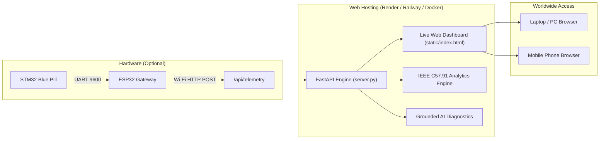

# Web Deployment Guide: GridGuard Transformer Health Monitoring

This repository is pre-configured for one-click deployment to popular cloud hosting platforms, container environments, or instant local tunnels.

---

## Architecture in the Cloud



---

## Option 1: Render.com (Recommended — 100% Free & Easiest)

Render provides a free web service tier with automated SSL (HTTPS) and continuous deployment from GitHub.

### Steps:
1. **Push your code to GitHub**:
   ```powershell
   git add .
   git commit -m "Add production deployment configs"
   git push origin main
   ```
2. Go to **[Render.com](https://render.com/)** and sign in with GitHub.
3. Click **New +** > **Web Service**.
4. Select your repository: `Transformer-health-monitoring-and-prediction-system`.
5. Fill in the deployment settings (or Render will detect `render.yaml`):
   * **Name**: `gridguard-transformer-monitor` (or your choice)
   * **Language**: `Python 3`
   * **Build Command**: `pip install -r requirements.txt`
   * **Start Command**: `uvicorn server:app --host 0.0.0.0 --port $PORT`
   * **Plan**: `Free`
6. Click **Deploy Web Service**.
7. In ~2 minutes, your dashboard will be live at `https://gridguard-transformer-monitor.onrender.com`!

---

## Option 2: Railway.app (Fast Docker Deployment)

Railway provides one-click Docker deployments with zero manual configuration.

### Steps:
1. Go to **[Railway.app](https://railway.app/)** and log in with GitHub.
2. Click **New Project** > **Deploy from GitHub repo**.
3. Select this repository.
4. Railway will automatically detect the [`Dockerfile`](file:///e:/brainstroming/Transformer_Dashboard/Dockerfile) and [`Procfile`](file:///e:/brainstroming/Transformer_Dashboard/Procfile).
5. Go to **Settings** > **Networking** > click **Generate Domain**.
6. Your live URL will be ready immediately (e.g., `https://gridguard.up.railway.app`).

---

## Option 3: Instant Live Tunnel (Free 30-Second Web Demo)

If you have your **STM32 and ESP32 hardware connected to your laptop** and want to demo the project immediately over the internet without waiting for cloud builds:

### Using Cloudflare Tunnel (No account required):
```powershell
# In PowerShell:
winget install Cloudflare.cloudflared
cloudflared tunnel --url http://localhost:8080
```
*Cloudflare will print a public HTTPS link (e.g. `https://random-words.trycloudflare.com`) accessible worldwide.*

### Or using LocalTunnel via Node.js:
```powershell
npx localtunnel --port 8080
```

---

## Hardware Configuration (ESP32 to Cloud)

When your dashboard is hosted on the web, configure your ESP32 Wi-Fi gateway to post telemetry to your live web URL:

In [`src/main_esp32.cpp`](file:///e:/brainstroming/Transformer_Dashboard/src/main_esp32.cpp#L10) or [`esp32_gateway.ino`](file:///e:/brainstroming/Transformer_Dashboard/esp32_gateway.ino#L10):

```cpp
#include <WiFiClientSecure.h>
#include <HTTPClient.h>

// Update to your public cloud endpoint:
const char* serverUrl = "https://gridguard-transformer-monitor.onrender.com/api/telemetry";

// In loop():
WiFiClientSecure secureClient;
secureClient.setInsecure(); // Skip certificate verification on embedded ESP32

HTTPClient http;
http.begin(secureClient, serverUrl);
http.addHeader("Content-Type", "application/json");
int httpCode = http.POST(jsonTelemetry);
```

---

## Verification Checklist

- [x] `requirements.txt` generated with all core dependencies.
- [x] `server.py` updated to read `$PORT` from cloud environment variables.
- [x] `database.py` updated with automatic `scratch/` directory creation.
- [x] `Dockerfile` and `.dockerignore` created for container compatibility.
- [x] `render.yaml` blueprint created for 1-click cloud configuration.
- [x] Automated system test suite verified passing.
